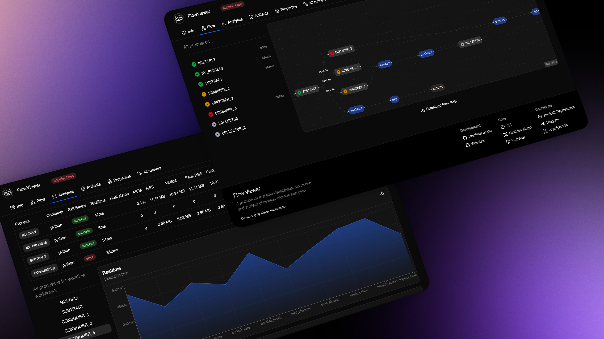

# nf-flowviewer

[](https://www.nextflow.io/)
[](./api)
[](LICENSE)

FlowViewer is a tool for real-time analysis of Nextflow pipeline execution. It helps gather statistics, view process graphs, and analyze output files;
* Constructs process graphs at the start of a session and updates the data within them in real time;
* Viewing session information: who started it, when, with which command, and in which environment;
* Visualization of files created during the pipeline execution;
* Detailed analytics of process telemetry.

The main advantage of FlowViewer is its `Self-Hosted` approach. You can deploy the tool on your own laboratory server, confident that your research data will not leak to third-party servers. Since the project is open-source, you can personally verify its security or customize the solution to create your own (non-commercial) build.

The plugin complies with nf-core requirements; it requires no script modifications to operate, allowing you to integrate it into existing pipelines and enjoy real-time statistics collection.

---

## Quick start

Launch the webview with the following command:

```shell
docker run -d \
  -p 3000:3000 \
  -v $(pwd)/data:/data \
  flow-viewer
```

> You can read more about WebView [here](https://github.com/voyadger1/flow-viewer/blob/master/apps/frontend/public/docs/web-view.md).

To launch the plugin, you need to specify the following in `nextflow.config`:

```groovy
plugins {
    id 'nf-flowviewer'
}

flowViewer {
    serverUrl = '<BASE_URL>'
}
```

| Parameter   | Description                                                               |
|-------------|---------------------------------------------------------------------------|
| `serverUrl` | Host for the statistics-gathering web application (http://localhost:3000) |

---

## WorkFlow

WorkFlow is the project name used to link project runs across different devices.

Since a single project can be run on different computers, WorkFlow serves as a connecting link that helps gather aggregated statistics from various runs.

The workflow is defined in the configuration:
```groovy
flowViewer {
    ...
    workflowName = 'project-1'
}
```

---

## Run by

To distinguish the devices from which the script was launched, there is a `RunBy` parameter. It can be specified either in the pipeline configuration or as an environment variable.

The value can be an arbitrary string and serves to specify the name of the specific developer running the script or the name of the server where the execution takes place.

Specifying RunBy via an environment variable:

```shell
export FLOWVIEWER_RUN_BY="developer-1"
```

Specifying RunBy via the config:

```groovy
flowViewer {
    ...
    runBy = 'developer-1'
}
```

> **⚠️ Priority**:
> a value set via an environment variable takes precedence over a value in the configuration.

---

## Artifacts

Artifacts are files generated during pipeline execution. You can view them in the relevant section of the specific pipeline's details, where a preview is also available.

> **⚠️ Important**: since pipelines can generate massive artifacts (tens of GB in size), it is advisable to limit their collection.

```groovy
flowViewer {
    ...
    artifactMaxSize = 512
}
```

`artifactMaxSize` - The maximum size of data read from the file, in bytes.

*512 bytes by default*

---

## Documentation

You can create Markdown documentation for any NextFlow file; this documentation will be available in the "info" section of the corresponding pipeline.

To create documentation, create an `.md` file next to the Nextflow pipeline launch file, using the same name:

```env
├─ main.nf
└─ main.md
```

OR

```env
├─ dna-seq.nf
└─ dna-seq.md
```

If the plugin does not find a file with the corresponding name, it will use the README.md file located in the same directory as the documentation.

```env
├─ main.nf
└─ README.md
```

## Links

* [Docker image](https://hub.docker.com/repository/docker/voyadger1/flow-viewer/general)
* [WebView Github](https://github.com/voyadger1/flow-viewer)

## License

Apache 2.0. See [LICENSE](LICENSE).
